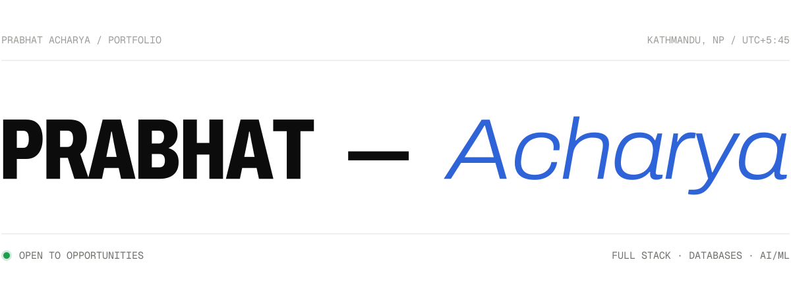
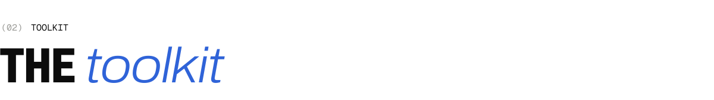

<a href="https://prabhatacharya.vercel.app"><picture><source media="(prefers-color-scheme: dark)" srcset="assets/header-dark.svg"></picture></a>

IT engineering graduate working across the data stack: full stack web development (Laravel, Vue.js), production
database administration (MySQL/Percona, replication, performance tuning) and AI/ML and RAG pipelines. I like turning
messy, unstructured data and legacy systems into reliable, well-documented software.

Currently working as a **Full Stack Developer Trainee** in Kathmandu.

 

<picture><source media="(prefers-color-scheme: dark)" srcset="assets/work-dark.svg"></picture>

| | Project | What it is | Stack |
|---|---|---|---|
| 01 | [**MediScan**](https://github.com/UnavoidableVOiD/MediScan) | Lab report → plain language. Extracts values, flags critical results, assesses risk and connects patients with a verified doctor. | Django · FastAPI · React · PostgreSQL · Docker |
| 02 | [**Netflix Data Science Pipeline**](https://github.com/UnavoidableVOiD/netflix-data-science-pipeline) | Raw CSV to an ML-powered dashboard: cleaning, EDA, TF-IDF recommender, forecasting, classifier, Vue 3 dashboard. | Python · scikit-learn · Plotly · Vue 3 |
| 03 | [**The Spirit Atlas**](https://the-spirit-atlas.vercel.app) | How the world's drinks are made, from grain to glass. Live at the-spirit-atlas.vercel.app. | React · Vite · D3 · Vercel |
| 04 | [**Online Voting System**](https://github.com/UnavoidableVOiD/online-voting-system-backend) | OTP, voter ID verification and live results. Built with [pratech143](https://github.com/pratech143). | PHP · MySQL · React · Redux |
| 05 | [**SocketTalk**](https://github.com/UnavoidableVOiD/c-socket-chat-file-transfer) | A LAN chatroom and file-sharing system over raw TCP sockets. | C · select() · pthreads |
| 06 | [**eKantipur Scraper**](https://github.com/UnavoidableVOiD/ekantipur-scrapper) | Top entertainment news and the daily cartoon, as JSON. | Python · Playwright · uv |

 

<picture><source media="(prefers-color-scheme: dark)" srcset="assets/toolkit-dark.svg"></picture>

<picture><source media="(prefers-color-scheme: dark)" srcset="https://img.shields.io/badge/Laravel-111010?style=for-the-badge&logo=laravel&logoColor=7fa8ff"></picture>
<picture><source media="(prefers-color-scheme: dark)" srcset="https://img.shields.io/badge/Vue.js-111010?style=for-the-badge&logo=vuedotjs&logoColor=7fa8ff"></picture>
<picture><source media="(prefers-color-scheme: dark)" srcset="https://img.shields.io/badge/React-111010?style=for-the-badge&logo=react&logoColor=7fa8ff"></picture>
<picture><source media="(prefers-color-scheme: dark)" srcset="https://img.shields.io/badge/TypeScript-111010?style=for-the-badge&logo=typescript&logoColor=7fa8ff"></picture>
<picture><source media="(prefers-color-scheme: dark)" srcset="https://img.shields.io/badge/Django-111010?style=for-the-badge&logo=django&logoColor=7fa8ff"></picture>
<picture><source media="(prefers-color-scheme: dark)" srcset="https://img.shields.io/badge/FastAPI-111010?style=for-the-badge&logo=fastapi&logoColor=7fa8ff"></picture>
<picture><source media="(prefers-color-scheme: dark)" srcset="https://img.shields.io/badge/Python-111010?style=for-the-badge&logo=python&logoColor=7fa8ff"></picture>
<picture><source media="(prefers-color-scheme: dark)" srcset="https://img.shields.io/badge/pandas-111010?style=for-the-badge&logo=pandas&logoColor=7fa8ff"></picture>
<picture><source media="(prefers-color-scheme: dark)" srcset="https://img.shields.io/badge/scikit--learn-111010?style=for-the-badge&logo=scikitlearn&logoColor=7fa8ff"></picture>
<picture><source media="(prefers-color-scheme: dark)" srcset="https://img.shields.io/badge/MySQL%20%2F%20Percona-111010?style=for-the-badge&logo=mysql&logoColor=7fa8ff"></picture>
<picture><source media="(prefers-color-scheme: dark)" srcset="https://img.shields.io/badge/PostgreSQL-111010?style=for-the-badge&logo=postgresql&logoColor=7fa8ff"></picture>
<picture><source media="(prefers-color-scheme: dark)" srcset="https://img.shields.io/badge/Redis-111010?style=for-the-badge&logo=redis&logoColor=7fa8ff"></picture>
<picture><source media="(prefers-color-scheme: dark)" srcset="https://img.shields.io/badge/Docker-111010?style=for-the-badge&logo=docker&logoColor=7fa8ff"></picture>
<picture><source media="(prefers-color-scheme: dark)" srcset="https://img.shields.io/badge/C-111010?style=for-the-badge&logo=c&logoColor=7fa8ff"></picture>

 

<picture><source media="(prefers-color-scheme: dark)" srcset="assets/contact-dark.svg"></picture>

Ask me about internships, freelance work or a collaboration.

<a href="mailto:prabhatacharya.work@gmail.com"><picture><source media="(prefers-color-scheme: dark)" srcset="https://img.shields.io/badge/prabhatacharya.work%40gmail.com-7fa8ff?style=for-the-badge&logo=gmail&logoColor=111010"></picture></a>
<a href="https://prabhatacharya.vercel.app"><picture><source media="(prefers-color-scheme: dark)" srcset="https://img.shields.io/badge/Portfolio-111010?style=for-the-badge&logo=vercel&logoColor=edeae4"></picture></a>
<a href="https://www.linkedin.com/in/prabhat-acharya-04997b172/"><picture><source media="(prefers-color-scheme: dark)" srcset="https://img.shields.io/badge/LinkedIn-111010?style=for-the-badge"></picture></a>
<a href="https://instagram.com/_prabhuja"><picture><source media="(prefers-color-scheme: dark)" srcset="https://img.shields.io/badge/Instagram-111010?style=for-the-badge&logo=instagram&logoColor=edeae4"></picture></a>
