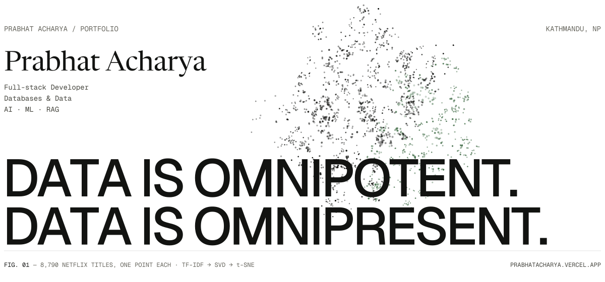
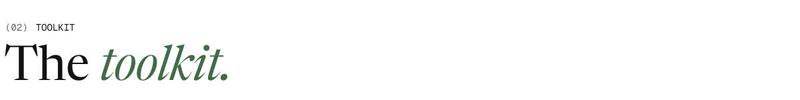

<a href="https://prabhatacharya.vercel.app"><picture><source media="(prefers-color-scheme: dark)" srcset="assets/lx-header-dark.svg"></picture></a>

IT engineering graduate working across the data stack: full stack web development (Laravel, Vue.js), production
database administration (MySQL/Percona, replication, performance tuning) and AI/ML and RAG pipelines. I like turning
messy, unstructured data and legacy systems into reliable, well-documented software.

Currently working as a **Full Stack Developer Trainee** in Kathmandu.

The banner above is real data: 8,790 Netflix titles from my [Netflix pipeline](https://github.com/UnavoidableVOiD/netflix-data-science-pipeline),
one point each, laid out with TF-IDF → SVD → t-SNE. Every page of [my portfolio](https://prabhatacharya.vercel.app) opens with a figure like it,
and the [Lab](https://prabhatacharya.vercel.app/lab.html) lets you play with them.

 

<picture><source media="(prefers-color-scheme: dark)" srcset="assets/lx-work-dark.svg"></picture>

| | Project | What it is | Stack |
|---|---|---|---|
| 01 | [**The Spirit Atlas**](https://the-spirit-atlas.vercel.app) | How the world's drinks are made, from grain to glass, with every claim cited. [Case study →](https://prabhatacharya.vercel.app/spirit-atlas.html) | React · Vite · R3F · d3-geo |
| 02 | [**MediScan**](https://github.com/UnavoidableVOiD/MediScan) | Lab report in, plain-language risk out. Team project: I led the AI/ML system (OCR, safety layer, six risk models, RAG). [Case study →](https://prabhatacharya.vercel.app/mediscan.html) | Python · scikit-learn · XGBoost · LangChain · FastAPI · Django · React |
| 03 | [**Netflix Data Science Pipeline**](https://github.com/UnavoidableVOiD/netflix-data-science-pipeline) | Raw CSV to a dashboard that runs its classifier in the browser, no server. [Case study →](https://prabhatacharya.vercel.app/netflix.html) | Python · scikit-learn · Plotly · Vue 3 |
| 04 | [**Mahabharata Quiz**](https://mahabharata-quiz.vercel.app) | A learning study: z-scores, Pearson correlation and a 20,000-play Monte Carlo balance check, as a personality quiz. | JavaScript · React · R3F |
| 05 | [**Online Voting System**](https://github.com/UnavoidableVOiD/online-voting-system-backend) | OTP, voter ID verification and live results. Built with [pratech143](https://github.com/pratech143). | PHP · MySQL · React · Redux |
| 06 | [**SocketTalk**](https://github.com/UnavoidableVOiD/c-socket-chat-file-transfer) | A LAN chatroom and file sharing over raw TCP sockets, one thread per client. | C · TCP · pthreads |
| 07 | [**eKantipur Scraper**](https://github.com/UnavoidableVOiD/ekantipur-scrapper) | Top entertainment news and the daily cartoon, as JSON. | Python · Playwright · uv |

 

<picture><source media="(prefers-color-scheme: dark)" srcset="assets/lx-toolkit-dark.svg"></picture>

<picture><source media="(prefers-color-scheme: dark)" srcset="https://img.shields.io/badge/Laravel-0d0e0d?style=for-the-badge&logo=laravel&logoColor=9fbf98"></picture>
<picture><source media="(prefers-color-scheme: dark)" srcset="https://img.shields.io/badge/Vue.js-0d0e0d?style=for-the-badge&logo=vuedotjs&logoColor=9fbf98"></picture>
<picture><source media="(prefers-color-scheme: dark)" srcset="https://img.shields.io/badge/React-0d0e0d?style=for-the-badge&logo=react&logoColor=9fbf98"></picture>
<picture><source media="(prefers-color-scheme: dark)" srcset="https://img.shields.io/badge/TypeScript-0d0e0d?style=for-the-badge&logo=typescript&logoColor=9fbf98"></picture>
<picture><source media="(prefers-color-scheme: dark)" srcset="https://img.shields.io/badge/FastAPI-0d0e0d?style=for-the-badge&logo=fastapi&logoColor=9fbf98"></picture>
<picture><source media="(prefers-color-scheme: dark)" srcset="https://img.shields.io/badge/Python-0d0e0d?style=for-the-badge&logo=python&logoColor=9fbf98"></picture>
<picture><source media="(prefers-color-scheme: dark)" srcset="https://img.shields.io/badge/pandas-0d0e0d?style=for-the-badge&logo=pandas&logoColor=9fbf98"></picture>
<picture><source media="(prefers-color-scheme: dark)" srcset="https://img.shields.io/badge/scikit--learn-0d0e0d?style=for-the-badge&logo=scikitlearn&logoColor=9fbf98"></picture>
<picture><source media="(prefers-color-scheme: dark)" srcset="https://img.shields.io/badge/LangChain-0d0e0d?style=for-the-badge&logo=langchain&logoColor=9fbf98"></picture>
<picture><source media="(prefers-color-scheme: dark)" srcset="https://img.shields.io/badge/MySQL%20/%20Percona-0d0e0d?style=for-the-badge&logo=mysql&logoColor=9fbf98"></picture>
<picture><source media="(prefers-color-scheme: dark)" srcset="https://img.shields.io/badge/Docker-0d0e0d?style=for-the-badge&logo=docker&logoColor=9fbf98"></picture>
<picture><source media="(prefers-color-scheme: dark)" srcset="https://img.shields.io/badge/C-0d0e0d?style=for-the-badge&logo=c&logoColor=9fbf98"></picture>

 

<picture><source media="(prefers-color-scheme: dark)" srcset="assets/lx-contact-dark.svg"></picture>

Ask me about a role, a project or a collaboration, or just say hello.

<a href="mailto:prabhatacharya.work@gmail.com"><picture><source media="(prefers-color-scheme: dark)" srcset="https://img.shields.io/badge/prabhatacharya.work%40gmail.com-9fbf98?style=for-the-badge&logo=gmail&logoColor=0d0e0d"></picture></a>
<a href="https://prabhatacharya.vercel.app"><picture><source media="(prefers-color-scheme: dark)" srcset="https://img.shields.io/badge/Portfolio-0d0e0d?style=for-the-badge&logo=vercel&logoColor=e8e4da"></picture></a>
<a href="https://www.linkedin.com/in/prabhat-acharya-04997b172/"><picture><source media="(prefers-color-scheme: dark)" srcset="https://img.shields.io/badge/LinkedIn-0d0e0d?style=for-the-badge&logoColor=e8e4da"></picture></a>
<a href="https://instagram.com/_prabhuja"><picture><source media="(prefers-color-scheme: dark)" srcset="https://img.shields.io/badge/Instagram-0d0e0d?style=for-the-badge&logo=instagram&logoColor=e8e4da"></picture></a>
