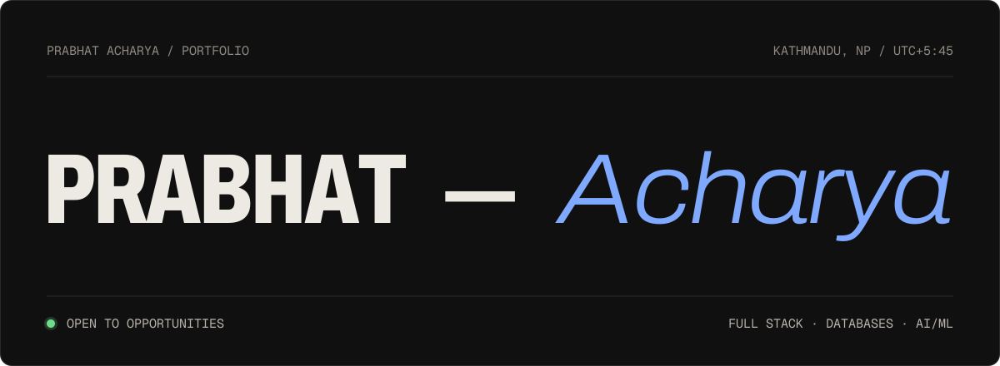
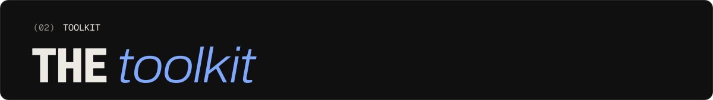

IT engineering graduate working across the data stack: full stack web development (Laravel, Vue.js), production
database administration (MySQL/Percona, replication, performance tuning) and AI/ML and RAG pipelines. I like turning
messy, unstructured data and legacy systems into reliable, well-documented software.

Currently working as a **Full Stack Developer Trainee** in Kathmandu.

 

| | Project | What it is | Stack |
|---|---|---|---|
| 01 | [**MediScan**](https://github.com/UnavoidableVOiD/MediScan) | Lab report → plain language. Extracts values, flags critical results, assesses risk and connects patients with a verified doctor. | Django · FastAPI · React · PostgreSQL · Docker |
| 02 | [**Netflix Data Science Pipeline**](https://github.com/UnavoidableVOiD/netflix-data-science-pipeline) | Raw CSV to an ML-powered dashboard: cleaning, EDA, TF-IDF recommender, forecasting, classifier, Vue 3 dashboard. | Python · scikit-learn · Plotly · Vue 3 |
| 03 | [**The Spirit Atlas**](https://the-spirit-atlas.vercel.app) | How the world's drinks are made, from grain to glass. Live at the-spirit-atlas.vercel.app. | React · Vite · D3 · Vercel |
| 04 | [**Online Voting System**](https://github.com/UnavoidableVOiD/online-voting-system-backend) | OTP, voter ID verification and live results. Built with [pratech143](https://github.com/pratech143). | PHP · MySQL · React · Redux |
| 05 | [**SocketTalk**](https://github.com/UnavoidableVOiD/c-socket-chat-file-transfer) | A LAN chatroom and file-sharing system over raw TCP sockets. | C · select() · pthreads |
| 06 | [**eKantipur Scraper**](https://github.com/UnavoidableVOiD/ekantipur-scrapper) | Top entertainment news and the daily cartoon, as JSON. | Python · Playwright · uv |

 

 

Ask me about internships, freelance work or a collaboration.

